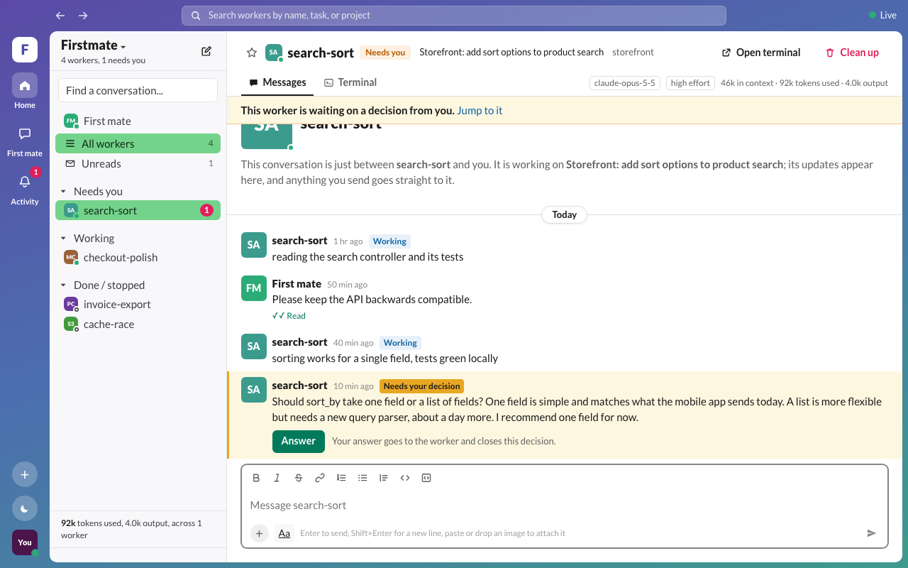
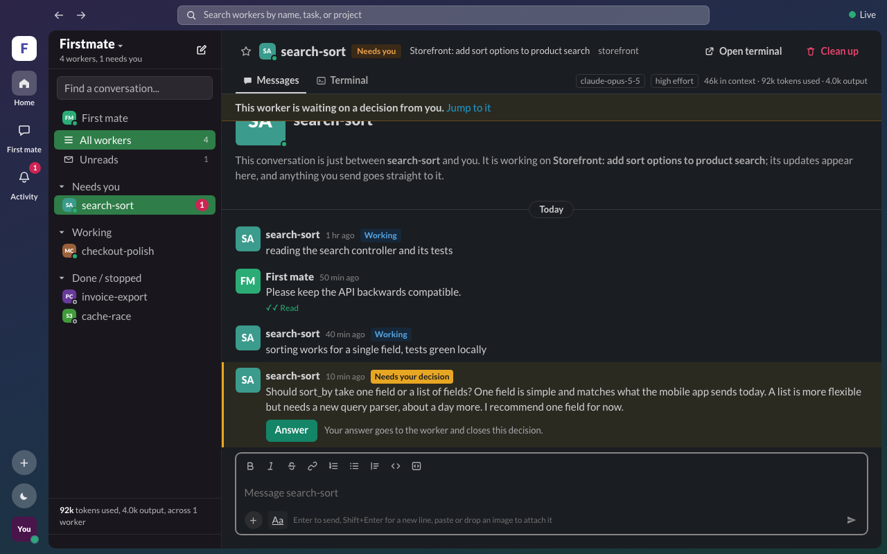
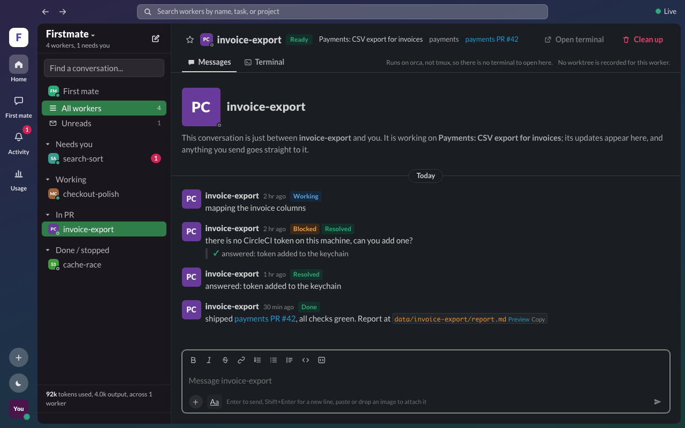
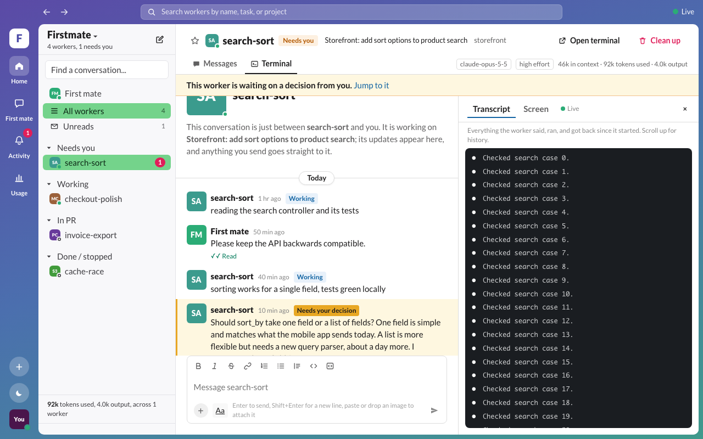
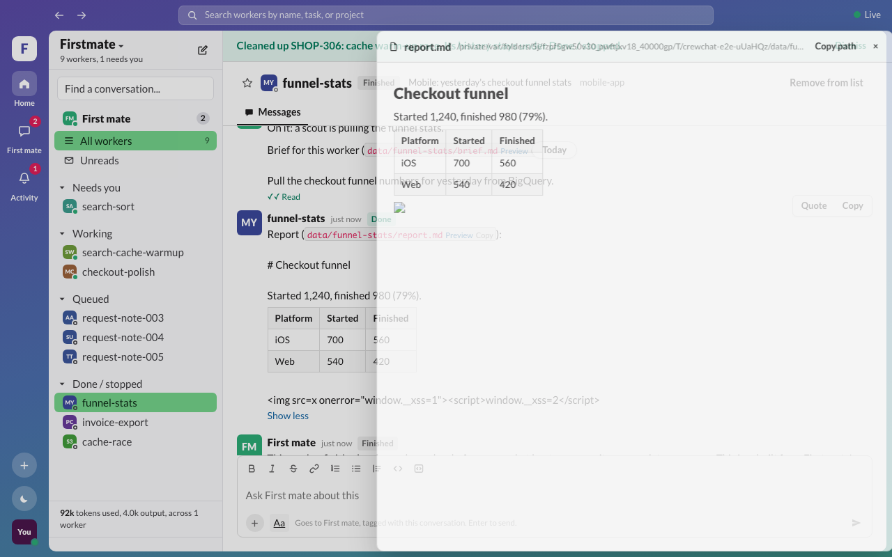
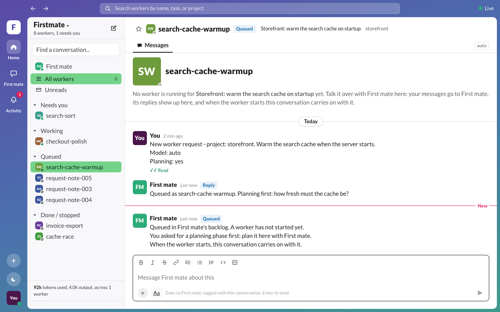
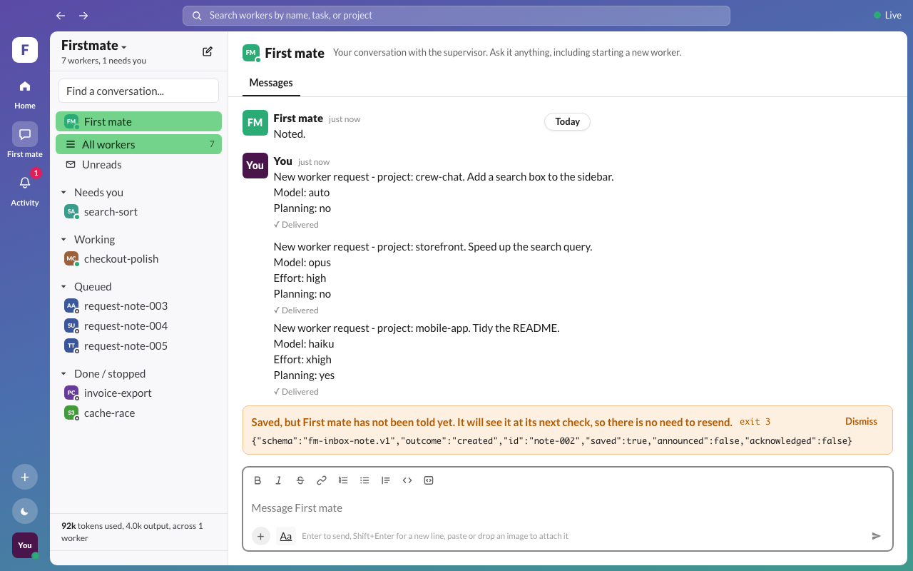
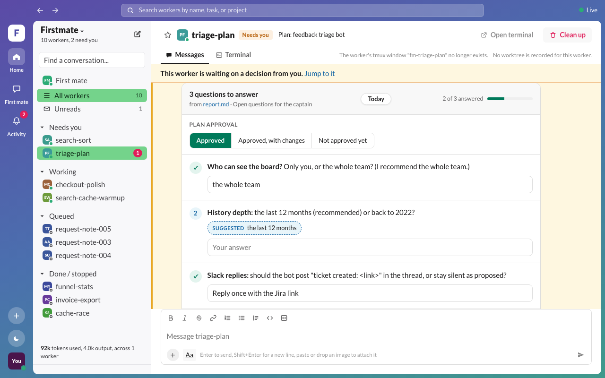

# crew-chat

[](https://github.com/ToddZeil/crew-chat/actions/workflows/ci.yml)
[](LICENSE)

A local web interface for [Firstmate](https://github.com/kunchenguid/firstmate). Each worker gets its own conversation, so you can follow its progress, answer its questions, and open its terminal without reading through one combined supervisor chat.

crew-chat is an independent project. It is not part of Firstmate and is not maintained by its authors.



## Features

- **One conversation per worker.** Status updates arrive as messages as they are written. Unread messages are marked, and conversations are grouped into *Needs you*, *Working*, *Queued*, and *Done / stopped*.
- **Decisions.** A worker's open decision shows an Answer button. The answer is delivered to the worker, and the decision is closed in Firstmate's records.
  - When a decision asks several questions, in its own text or in the "Open questions" section of the worker's report, they are listed one by one, each with its own answer field and the worker's suggestion where it gave one.
  - Plan approvals and lettered options such as (A) and (B) are shown as buttons.
  - Everything is sent as one numbered reply, and questions left blank are listed as not answered yet.
- **Terminal access.**
  - **Transcript** shows the worker's session history (Claude Code workers).
  - **Screen** mirrors its live terminal, with scrollback.
  - **Open terminal** opens the worker's tmux window in a new terminal.
- **First mate.** A conversation with the supervisor. Includes a form for requesting a new worker, with project, model, effort, and an optional planning step. Its Terminal tab shows First mate's session read-only: the Transcript always, and the Screen when First mate runs in tmux. Claude Code accepts some approvals only when they are typed in First mate's own terminal, so when a reply asks for one, a button copies the words to type, and opens that terminal when it is a tmux window running First mate. crew-chat never types into it.
- **Queued and finished work.** Requests and backlog tasks without a running worker appear as queued conversations. Workers that have been cleaned up keep their history and can be hidden.
- **Attachments and previews.**
  - Paste or drop images into a message.
  - Markdown and terminal tables are rendered.
  - Markdown files open in a side panel, and images open in a viewer.
- **Usage.** Model, effort, context size, and token use for each worker, with a total for all workers. Claude plan usage (5-hour and 7-day windows, and when the 5-hour window resets) is shown under the total, read from the status bar of the most recently active Claude worker. It appears only if your Claude Code status line prints those figures, for example `5h:76% (resets in 0h6m) 7d:86% (resets in 2d3h)`; each window's reset time is shown when the status line includes it.
- **Quick actions.** Right-click a worker in the sidebar, or use its ⋯ button, to open its conversation or terminal, jump to its open decision, star it, mark it read or unread, copy its name or link, or clean it up. Queued and requested work can be removed from the list or cancelled through First mate.
- **Clean up.** Runs Firstmate's teardown for a worker. If the worker has unlanded changes, the reason is shown, and discarding them requires typing the worker's id.

## Requirements

- macOS or Linux
- Node.js 23.6 or later (24 recommended)
- A Firstmate home on the same machine (the directory containing Firstmate's `bin/` and `state/`)
- tmux, as used by Firstmate for its workers
- Claude Code workers, optional: needed for the Transcript tab and token counts

## Installation

```sh
git clone https://github.com/ToddZeil/crew-chat.git
cd crew-chat
npm ci
```

## Usage

```sh
FM_HOME=/path/to/firstmate npm start
```

Then open <http://127.0.0.1:4477>.

On startup, crew-chat checks that the Firstmate scripts it uses are present. Missing scripts, and the features they affect, are reported in the log and in the interface.

On macOS, the first use of Open terminal triggers a system prompt asking for permission to control Terminal. You can also allow it under System Settings, Privacy & Security, Automation.

To keep the server running after the terminal is closed:

```sh
FM_HOME=/path/to/firstmate nohup npm start > ~/.crew-chat.log 2>&1 &
```

To update, run `git pull && npm ci` and restart. crew-chat stores its own data in `~/.crew-chat`, which can be deleted to remove it completely.

## Configuration

| Variable | Description |
| --- | --- |
| `FM_HOME` | Required. Path to the Firstmate home. |
| `CREW_CHAT_PORT` | Port to listen on. Default `4477`. |
| `CREW_CHAT_READ_ONLY` | Set to `1` to disable sending, answering, opening terminals, cleanup, and notes to First mate. |
| `CREW_CHAT_DATA_DIR` | crew-chat's data directory. Default `~/.crew-chat`. Must be outside `FM_HOME`. |
| `CREW_CHAT_UPLOAD_DIR` | Directory for pasted images. Default `uploads/` inside the data directory. |
| `CREW_CHAT_CLAUDE_PROJECTS` | Claude Code transcript directory. Default `$CLAUDE_CONFIG_DIR/projects` or `~/.claude/projects`. |
| `CREW_CHAT_NO_USAGE` | Set to `1` to stop reading transcripts. Disables token counts and the Transcript tab. |
| `CREW_CHAT_TMUX_SOCKET` | tmux server to use, as a socket name (`tmux -L`) or path (`tmux -S`). |
| `CREW_CHAT_FIRSTMATE_WINDOW` | First mate's own tmux window (`session:window`, by name or index), shown in its Terminal tab and opened by the approval hand-off. Default `firstmate:0`, Firstmate's own fallback. Used only while that window is running an agent rather than a plain shell. |
| `CREW_CHAT_TERMINAL_CMD` | Command used by Open terminal, with `{cmd}` as a placeholder, for example `gnome-terminal -- sh -c {cmd}`. Defaults to Terminal.app on macOS and `x-terminal-emulator` on Linux. |

## How it works

crew-chat is a small Node server and a React page. The server:

- reads worker records, update logs, and inboxes from `$FM_HOME/state`
- watches that directory for changes and pushes updates to the page
- reads Firstmate's backlog and the briefs and reports under `$FM_HOME/data`

It does not write to `$FM_HOME`. All changes go through Firstmate's own scripts, called with argument lists and never through a shell:

| Action | Command |
| --- | --- |
| Send a message | `fm-send.sh <id> <text>` |
| Answer a decision | `fm-send.sh <id> --resolve-key <key> <text>` |
| Message First mate | `fm-inbox.sh note --request-id <uuid> --json -- <text>` |
| Clean up a worker | `fm-teardown.sh <id>`, with `--force` only after explicit confirmation |

Open decisions are determined by the same rules Firstmate uses, so an Answer button appears exactly when `fm-send.sh --resolve-key` will accept the answer.

Firstmate's inbox records do not identify the sender. crew-chat keeps a list of the messages it has sent, so it can show those as yours and everything else as First mate's.

## Compatibility

crew-chat depends on Firstmate's on-disk formats and script interfaces, which are internal to Firstmate and may change between releases. This version was tested against Firstmate commit `1d43f9cb` (2026-11-10).

| Platform | Status |
| --- | --- |
| macOS | Supported. Open terminal uses Terminal.app. |
| Linux | Supported. Open terminal uses `x-terminal-emulator`, or the command in `CREW_CHAT_TERMINAL_CMD`. |
| Windows | Not tested. |

## Security

crew-chat listens on 127.0.0.1 only and has no authentication. Do not expose it to other machines.

- **Cross-site requests.** Write requests from other sites are rejected.
- **File previews.** Files are served only from the Firstmate home, the worker's worktree, or the uploads directory.
- **Untrusted content.** Rendered Markdown is sanitised.
- **Data stays local.** Transcripts and other files read by crew-chat are not sent anywhere.

See [SECURITY.md](SECURITY.md) for details and for reporting vulnerabilities.

## Screenshots

| | |
| --- | --- |
|  |  |
|  |  |
|  |  |
|  | |

## Development

```sh
FM_HOME=/path/to/firstmate npm run dev   # development server with hot reload on port 5180
npm run typecheck
npm test                                 # unit tests
npx playwright install chromium          # first time only
npm run test:e2e                         # browser tests
```

Tests run against a temporary Firstmate home whose scripts are stubs that record their arguments, so they never modify a real home. tmux tests use a private tmux server. The browser tests also regenerate the screenshots in `docs/screenshots/`. CI runs both suites on macOS and Ubuntu.

Bug reports and pull requests are welcome. For larger changes, please open an issue first.

## License

[MIT](LICENSE)
