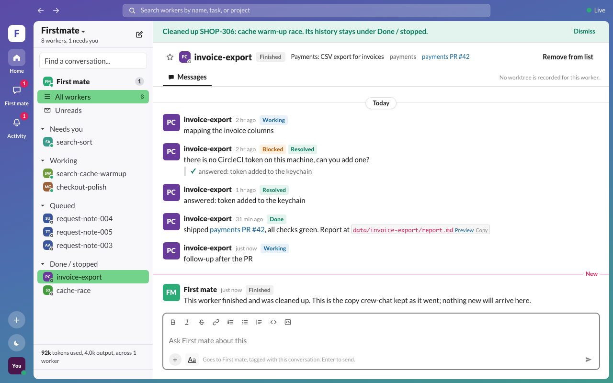
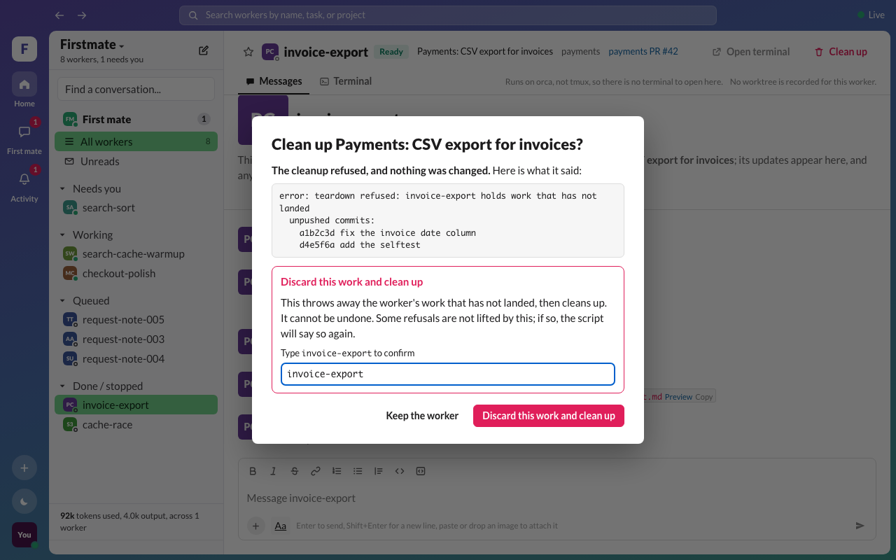
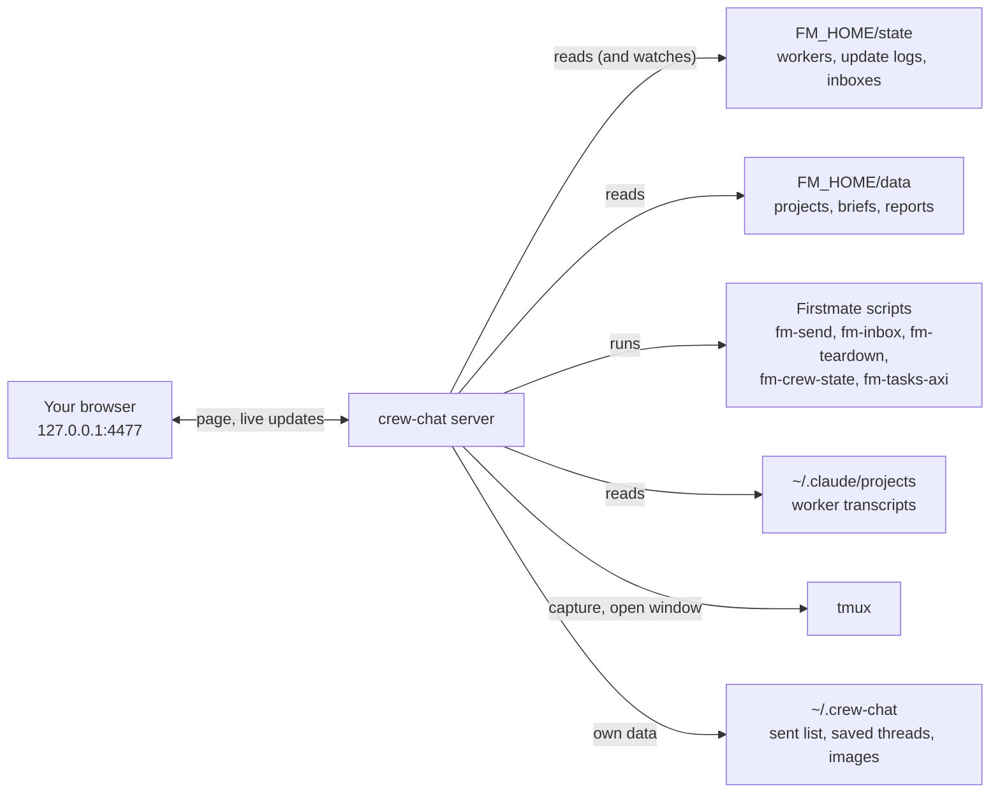

<div align="center">

# 💬 crew-chat

**Every Firstmate worker gets its own chat. See what each one is doing, answer it, and step into its terminal, all from one browser tab.**

[](https://github.com/ZeilLabs/crew-chat/actions/workflows/ci.yml)
[](LICENSE)


An unofficial companion to [**Firstmate**](https://github.com/kunchenguid/firstmate): talk to one agent, ship with a crew, and now follow the crew one conversation at a time.


</div>

---

## ✨ Why

Firstmate runs a whole crew of coding agents, but everything they report lands in one supervisor chat. crew-chat splits that into a team-chat layout you already know. There is one direct conversation per worker, a sidebar that shows who needs you, and every action is one click away. It runs on your machine, reads Firstmate's own files, and changes things only through Firstmate's own scripts.

## 🚀 Features

| | |
| --- | --- |
| 🧵 **One conversation per worker** | Live updates as they happen, grouped by sender, split by day, with a red **New** line where your unread messages start. |
| 🚦 **Who needs you, at a glance** | Sections for **Needs you**, **Working**, **Queued**, and **Done / stopped**. Red counts show open decisions. The browser tab shows **!** and a red dot whenever something waits on you. |
| ✅ **Answer decisions in place** | A decision has an **Answer** button. Your reply goes to the worker and closes the decision in Firstmate's records. |
| 🖥️ **Terminal beside the chat** | **Transcript** shows everything the worker said, ran, and got back. **Screen** mirrors its live terminal, with scrollback, even for full-screen programs. **Open terminal** jumps into its real tmux window. |
| 🧭 **First mate, too** | A pinned conversation with the supervisor. **New worker** lets you pick the project, model, effort, and *plan it first*. The request gets its own conversation straight away. |
| 🗂️ **Nothing disappears** | Work without a worker yet shows under **Queued**. Cleaned-up workers stay as **Finished** with their full history. Remove the ones you don't need. |
| 🖼️ **Rich messages** | Paste or drag images in. Markdown and terminal tables render properly. Click any `.md` or image path for a clean preview. |
| 📊 **Model and token use** | Each worker's model, effort, context size, and tokens used, plus a total across the crew. |
| 🧹 **Safe clean-up** | **Clean up** runs Firstmate's own teardown. If work hasn't landed, it shows you why, and discarding needs you to type the worker's id. |
| 🌗 **Light and dark** | Follows your system, or pick from the moon on the rail. |

## 🏁 Quick start

**You need:**

- **macOS or Linux** with **Node.js 23.6 or newer** (24 recommended). crew-chat's server is TypeScript that Node runs directly.
- A working **[Firstmate](https://github.com/kunchenguid/firstmate) home** on the same machine: the folder with Firstmate's `bin/` and `state/`.
- **tmux**, which Firstmate uses for its workers. Open terminal and the Screen tab need it.
- Optional: **Claude Code** workers, for the Transcript tab and token counts.

**Then:**

```sh
git clone https://github.com/ZeilLabs/crew-chat.git
cd crew-chat
npm ci
FM_HOME=/path/to/your/firstmate npm start
```

Open **<http://127.0.0.1:4477>**. Your workers appear in the sidebar straight away.

> **macOS:** the first time you use **Open terminal**, macOS asks whether your terminal or Node may control Terminal.app. Allow it once in System Settings, then Privacy & Security, then Automation.

At startup crew-chat checks your Firstmate home. If a script it needs is missing, the log and the page both say which features are affected.

### Keep it running

`npm start` rebuilds the page and starts the server in the foreground. To keep it running after you close the terminal:

```sh
FM_HOME=/path/to/your/firstmate nohup npm start > ~/.crew-chat.log 2>&1 &
```

### Update or remove

```sh
git pull && npm ci          # update, then start it again
rm -rf ~/.crew-chat         # remove crew-chat's own data (sent list, saved threads, pasted images)
```

## ⚙️ Configuration

| Variable | What it does |
| --- | --- |
| `FM_HOME` | **Required.** Your Firstmate home. |
| `CREW_CHAT_PORT` | Port to listen on (default `4477`). |
| `CREW_CHAT_READ_ONLY=1` | Look but don't touch: turns off Send, Answer, Open terminal, Clean up, and notes to First mate. |
| `CREW_CHAT_DATA_DIR` | crew-chat's own data folder (default `~/.crew-chat`). It must be outside `FM_HOME`. |
| `CREW_CHAT_UPLOAD_DIR` | Where pasted images go (default `uploads/` in the data folder). |
| `CREW_CHAT_CLAUDE_PROJECTS` | Claude Code transcript folder (default `$CLAUDE_CONFIG_DIR/projects` or `~/.claude/projects`). |
| `CREW_CHAT_NO_USAGE=1` | Don't read transcripts at all: no token counts or Transcript tab. |
| `CREW_CHAT_TMUX_SOCKET` | Use a different tmux server: a name (as `tmux -L`) or a socket path (as `tmux -S`). |
| `CREW_CHAT_TERMINAL_CMD` | How Open terminal opens a window, with a `{cmd}` placeholder, for example `gnome-terminal -- sh -c {cmd}`. The default is Terminal.app on macOS and `x-terminal-emulator` on Linux. |

## 📸 Tour

| | |
| --- | --- |
|  |  |
| **A decision waiting on you** (dark) | **A finished piece of work, with its PR** (dark) |
|  |  |
| **The worker's session history beside the chat** | **Click a report to preview it, tables and all** |
|  |  |
| **Planning a new worker with First mate** | **Your conversation with the supervisor** |
|  |  |
| **History kept after clean-up** | **Clean-up that won't throw away unlanded work** |

## 🔧 How it works



- **Read-only on Firstmate's files.** crew-chat never writes inside `FM_HOME`. Every change goes through Firstmate's own scripts, run with an argument list and never through a shell:
  - Send: `fm-send.sh <id> <text>`
  - Answer: `fm-send.sh <id> --resolve-key <key> <text>`
  - Clean up: `fm-teardown.sh <id>`, and `--force` only after you type the id
  - Notes to First mate: `fm-inbox.sh note --request-id <uuid> --json -- <text>`
- **The same decision rules as Firstmate.** Open decisions are worked out the same way Firstmate does it. So the Answer button appears exactly when `fm-send.sh --resolve-key` will accept the answer.
- **Who said what.** Firstmate's inbox doesn't record a sender, so crew-chat keeps its own list of what it sent. Your messages show as **You**, and anything else as **First mate**.
- **Live.** The server watches `FM_HOME/state` and pushes changes to the page as they happen.

## 🧩 Compatibility

crew-chat reads Firstmate's internal files and calls its scripts, which can change between Firstmate releases. It was built and tested against Firstmate commit `1d43f9cb` (2026-11-10). The startup check names any script that is missing.

| Platform | Status |
| --- | --- |
| macOS | ✅ Everything works. Open terminal uses Terminal.app. |
| Linux | ✅ Everything works. Open terminal uses `x-terminal-emulator`, or set `CREW_CHAT_TERMINAL_CMD`. Paste with Ctrl+V. |
| Windows | Untested. |

## 🔒 Security and privacy

- crew-chat listens on **127.0.0.1 only** and has no login. Don't expose it beyond your machine.
- It refuses write requests that come from other sites.
- It previews files only from the Firstmate home, the worker's own worktree, or its uploads folder.
- It renders worker text as untrusted, sanitised HTML.
- Nothing it reads leaves your machine.

See [SECURITY.md](SECURITY.md) for details and how to report a problem.

## 🧪 Development

```sh
FM_HOME=/path/to/firstmate npm run dev   # hot reload on http://127.0.0.1:5180
npm run typecheck
npm test                                 # unit tests
npx playwright install chromium          # once, for the browser tests
npm run test:e2e                         # builds the page and drives it in headless Chromium
```

Both test suites run against a throwaway fake Firstmate home whose scripts only record their arguments, so no test touches a real home. tmux tests use a private tmux server. The browser tests record the Open terminal command instead of opening a window, and they regenerate the screenshots in `docs/screenshots/`. CI runs everything on macOS and Ubuntu.

Contributions are welcome. Open an issue first for anything big.

## 📄 License

MIT. See [LICENSE](LICENSE).
