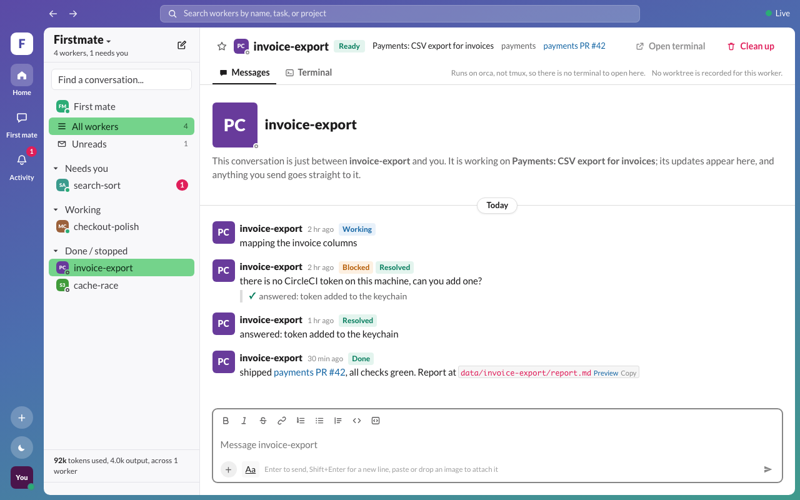

# Crew chat

An unofficial companion to [Firstmate](https://github.com/kunchenguid/firstmate).

A local chat page for Firstmate workers, laid out like a team chat app. Each
live worker is a direct-message conversation of its own, so you can follow
each worker's updates and reply to it there, instead of reading everything in
one Firstmate chat.


- The sidebar pins **First mate**, your conversation with the supervisor, at the
  top. Below it, conversations are grouped into collapsible **Needs you**,
  **Working**, **Queued**, and **Done / stopped** sections, newest activity
  first in each. A green dot marks a worker that is active, and a red count
  shows open decisions. Conversations with updates you have not opened show in
  bold, with an unread count.
- **Home** on the left rail shows all workers, and **Activity** narrows the
  list to what needs you (unread updates and open decisions). The browser tab
  shows "!" and a red dot on its icon while something needs you.
- Star a conversation to keep it in a **Starred** section at the top. When you
  open a conversation, a red **New** line marks where your unread messages
  start. Hovering a message offers **Copy** and **Quote** (into your reply).
- **Queued** shows work that has no live worker yet: a task waiting in First
  mate's backlog, or a New worker request First mate has not picked up. Its
  conversation holds your request and First mate's replies, and anything you
  type there goes to First mate. When the worker starts, the same conversation
  carries on with it.
- A worker that finishes and is cleaned up stays under Done / stopped as
  **Finished**, with the history crew-chat kept as it went. A recently finished
  task that was cleaned up before crew-chat kept a copy is rebuilt from First
  mate's notes and the task's brief and report. **Remove from list** hides a
  finished conversation, and **Show removed** brings it back.
- Each conversation's header shows the worker's state (**Needs you**,
  **Working**, **Ready**, or **Stopped**), its task, project, and PR. It also
  shows the model and effort the worker runs with, and its token use: how full
  its context is, and the tokens used since it started. The sidebar shows the
  total across all workers.
- Worker updates appear as messages from the worker, each tagged "Needs your
  decision", "Done", "Blocked", or "Working". Messages show a relative time
  (hover for the exact time) and are split by day dividers. Consecutive messages
  from the same sender are grouped. PR links and file paths are clickable, and
  long updates collapse behind "Show more".
- Messages you send appear from **You**. Messages the supervisor sends the
  worker appear from **First mate**. Both are marked **Read** once the worker
  has picked them up. Firstmate's inbox records do not say who sent them, so
  crew-chat keeps its own list of the messages it sent
  (`sent-ledger.jsonl` in its data folder). Any other inbox message, including
  ones from before crew-chat was running, is shown as First mate.
- The message box has a formatting toolbar (bold, italic, strikethrough, link,
  lists, quote, code) that writes Markdown around the selected text.
- To attach an image, paste it with Cmd+V (in the message box or anywhere in
  the conversation), drag it onto the message box, or pick it with **+**. The image is saved
  outside the Firstmate home, and the message carries its file path as
  `[image: <path>]`, so the worker can open it. Sent images show inline.
- Enter sends and Shift+Enter starts a new line. The box clears only after the send
  succeeds. If the send script refuses, its reason shows in the thread.
- An update that waits on a decision has an **Answer** button. Answering sends your
  reply and closes the decision in Firstmate's records, and the message then shows
  as resolved.
- The **Terminal** tab opens a panel beside the chat. **Transcript** shows
  everything the worker said, ran, and got back since it started (Claude
  workers). **Screen** shows its live terminal; lines that scroll off stay in
  the panel while it is open, so you can scroll back even through a
  full-screen program that keeps no scrollback of its own.
- **Open terminal** opens the worker's live tmux window in a new Terminal.app
  window. It uses a separate grouped session, so other attached clients stay on
  the window they are on.
- **New worker** (the round button at the top of the sidebar) asks First mate
  to start a worker. You pick a project, a model (Auto, Sonnet, or Opus, plus
  effort), whether to **plan it first**, and say what it should do. The
  request opens straight away as its own conversation under Queued, which is
  also where any planning with First mate happens.
- **Clean up** runs Firstmate's own teardown for a worker you no longer need. If
  the worker holds work that has not landed, the teardown refuses and the page
  shows why. Discarding that work takes a second step: you type the worker's id
  first.
- Everything updates live as the files change, with no page refresh.
- Light and dark mode follow your system setting by default. The moon button
  on the left rail opens **Auto / Light / Dark** to override it, and the page
  remembers your choice.

## Install

Requires Node.js 23.6 or newer, which runs the TypeScript server directly. It
also needs macOS for Open terminal (Terminal.app and `tmux` on `PATH`).

```sh
npm ci
```

## Run

Set `FM_HOME` to your Firstmate home. The server refuses to start without it.

```sh
FM_HOME=/path/to/firstmate npm start
```

This builds the page and serves it at <http://127.0.0.1:4477>. The server listens
on 127.0.0.1 only.

| Variable | Meaning |
| --- | --- |
| `FM_HOME` | Required. The Firstmate home to read from. |
| `CREW_CHAT_PORT` | Port to listen on (default 4477). |
| `CREW_CHAT_READ_ONLY=1` | Show everything, but turn off Send, Answer, Open terminal, Clean up, and notes to First mate. |
| `CREW_CHAT_DATA_DIR` | crew-chat's own data folder (default `~/.crew-chat`): the list of messages it sent, its saved copy of each thread, the list of removed threads, and pasted images. It must be outside `FM_HOME`. |
| `CREW_CHAT_UPLOAD_DIR` | Where pasted images are saved (default `uploads/` in the data folder). It must be outside `FM_HOME`. |
| `CREW_CHAT_CLAUDE_PROJECTS` | Claude Code's transcript folder, read for token use (default `$CLAUDE_CONFIG_DIR/projects` or `~/.claude/projects`). |
| `CREW_CHAT_NO_USAGE=1` | Do not read token use at all. |
| `CREW_CHAT_TMUX_SOCKET` | tmux server to use: a name (as `tmux -L`) or a socket path (as `tmux -S`). By default it uses the default tmux server, where Firstmate's workers run. |
| `CREW_CHAT_TERMINAL_CMD` | How Open terminal opens a window: an argument list with a `{cmd}` placeholder, for example `gnome-terminal -- sh -c {cmd}`. By default macOS uses Terminal.app and Linux uses `x-terminal-emulator`. |

For development with hot reload, run `FM_HOME=... npm run dev`. That starts the
page on <http://127.0.0.1:5180> and the API on the next port up.

## How it talks to Firstmate

It reads these files under `$FM_HOME/state/` and never writes to them:

- `<id>.meta`: one per live worker. A thread exists while this file exists.
- `<id>.status`: the worker's update log. Open decisions follow the same rules
  Firstmate uses, so the Answer button appears exactly when `fm-send.sh
  --resolve-key` will accept it.
- `<id>.inbox/` and `<id>.inbox/handled/`: messages sent to the worker, unread
  and read.
- `$FM_HOME/data/projects.md`: the project list in the New worker form.
- `bin/fm-tasks-axi.sh list`: First mate's backlog, for the Queued and
  Finished conversations, and `$FM_HOME/data/<task>/brief.md` and the task's
  report for finished tasks it rebuilds.

Token use is read from each Claude worker's own Claude Code transcripts. These
live in the projects folder under the worker's `worktree=` path. Only messages
since the worker started (`spawn_gen=`) count, because pool worktrees are reused
by later tasks. The transcripts are only read, and nothing from them leaves the
machine. Workers on other harnesses show their model and effort but no token
count.

Badges come from `bin/fm-crew-state.sh <id>`, and titles come from
`bin/fm-tasks-axi.sh show <id>`. The First mate conversation comes from
`bin/fm-inbox.sh receipts`, which reports each note's state and First mate's
replies.

Every change goes through the home's own scripts. Each is run with an argument
list, never through a shell:

- Send: `bin/fm-send.sh <id> <text>`
- Answer: `bin/fm-send.sh <id> --resolve-key <key> <text>`
- Clean up: `bin/fm-teardown.sh <id>`. After a refusal, if you type the id,
  `bin/fm-teardown.sh <id> --force`.
- A note to First mate, including a New worker request:
  `bin/fm-inbox.sh note --request-id <uuid> --json -- <text>`. Each message gets
  its own request id, and a retry of the same text reuses it, so a retry never
  creates a second note.

## Compatibility

crew-chat reads Firstmate's own files and calls its scripts, which are Firstmate internals and can change between releases. It was built and tested against Firstmate at commit `1d43f9cb` (2026-11-10).

At startup it checks for `fm-crew-state.sh`, `fm-tasks-axi.sh`, `fm-send.sh`, `fm-inbox.sh`, and `fm-teardown.sh`. If any are missing, it says so in its log and on the page, and names the features they affect.

## Platforms

- **macOS:** everything works. Open terminal uses Terminal.app.
- **Linux:** everything works except that Open terminal needs a terminal app. It uses `x-terminal-emulator` when present; otherwise set `CREW_CHAT_TERMINAL_CMD`. Paste images with Ctrl+V.
- **Windows:** untested.

## Security and privacy

crew-chat listens on 127.0.0.1 only and has no login, so do not expose it beyond your machine. It reads Claude Code transcripts under `~/.claude/projects` for token use and the Transcript tab. Nothing it reads leaves your machine. See [SECURITY.md](SECURITY.md) for details and how to report a problem.

## Tests

```sh
npm test            # parsers, token use, send, note, upload and cleanup routes, tmux command (private tmux server)
npm run test:e2e    # builds the page and drives it in headless Chromium
```

Both suites run against a temporary fake Firstmate home. Its `bin/` scripts are
stubs that record their arguments, so no test writes to a real home. The tmux
tests use a private tmux server on a socket in a temporary directory. The e2e
suite records the Open terminal AppleScript instead of running it, and refreshes
the screenshots in `docs/screenshots/`. If Playwright has no Chromium, install it
first with `npx playwright install chromium`.

| | |
| --- | --- |
|  |  |
|  |  |
|  | |

## License

MIT. See [LICENSE](LICENSE).
